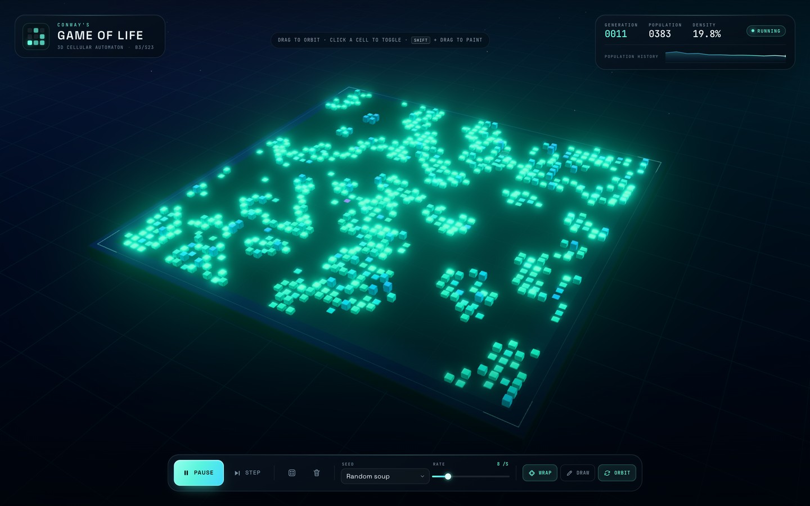

# Game of Life · 3D

Developed by **DeepSeek-V4.1-Flash-1017(max)**.

A Conway's Game of Life you can orbit, paint and watch evolve — rendered as a
glowing field of three-dimensional cells with [three.js](https://threejs.org/).

> **Developed by DeepSeek-V4.1-Flash-1017(max).**

**One file. Fully offline.** [`index.html`](index.html) contains the app, the
compiled JavaScript, the CSS and the fonts. Open it directly in a browser; no
server, package install or network connection required.



## Play

Open [`index.html`](index.html) in a current browser (Chrome, Safari, Firefox or
Edge) with WebGL enabled.

| Action | Mouse | Touch | Keyboard |
| --- | --- | --- | --- |
| Orbit camera | Drag | Drag | — |
| Zoom | Scroll | Pinch | — |
| Toggle a cell | Click | Tap | — |
| Paint a stroke | Hold `Shift` + drag, or enable **Draw** | Enable **Draw**, then drag | `P` toggles Draw |
| Pause / resume | **Pause** button | **Pause** button | `Space` |
| Advance one generation | **Step** button | **Step** button | `S` |
| Randomize | Dice button | Dice button | `R` |
| Clear the board | Trash button | Trash button | `C` |
| Wrap edges on/off | **Wrap** toggle | **Wrap** toggle | `W` |
| Auto-orbit camera | **Orbit** toggle | **Orbit** toggle | `O` |
| Exit Draw mode | — | — | `Esc` |

Editing always pauses the simulation. Press **Pause / Play** to continue.

### Seeds

The **Seed** menu drops a curated pattern into the centre of the board and
restarts the world:

- **Random soup** — fresh primordial chaos each time
- **Glider** — the smallest spaceship
- **Lightweight spaceship** — a four-row glider
- **Pulsar** — a large period-3 oscillator
- **R-pentomino** — five cells, thousands of generations
- **Acorn** — seven cells with a famously long, chaotic life
- **Gosper glider gun** — fires a new glider every 30 generations

The board is a 44 × 44 torus by default. Toggle **Wrap** for bounded edges.

## Features

- Conway's B3/S23 rules on a typed-array simulation, with optional toroidal edges
- 1,936 InstancedMesh rounded cubes in a single draw call
- Custom GLSL cell shader: age-based height and a birth → teal → cyan → violet palette
- Smooth cell growth and decay, plus a wave-reveal on the first frame
- Bloom, FXAA and a subtle generated backdrop/starfield, all offline
- Orbit / zoom camera with a fitted, responsive framing that adapts to the HUD
- Live generation, population and density readouts with a population sparkline
- Click/tap editing, Shift-drag painting and a dedicated Draw mode for touch
- One-keystroke controls and a compact layout for phones and landscape screens
- Self-contained `index.html` (≈ 720 KB) with no CDN, fetch or external asset requests

## Development

```bash
npm install      # three, esbuild and playwright-core (dev-only)
npm run build    # writes the standalone index.html
npm test         # rules, patterns, wrapping and age unit tests (node:test)
npm run smoke    # headless Chrome UI/interaction checks + screenshots
npm run check    # test + build + smoke
```

The headless smoke test uses the locally installed Google Chrome by default.
Override the path if needed:

```bash
CHROME_PATH="/path/to/chrome" npm run smoke
```

Screenshots from the smoke run are written to `artifacts/`.

### How the single file is built

`scripts/build.mjs`:

1. Bundles `src/main.js` (and three.js) with esbuild into a minified IIFE.
2. Inlines `src/styles.css`, including the two variable WOFF2 fonts as base64
   `data:` URLs.
3. Injects both into `src/index.html` and writes the complete `index.html`.

There are no runtime imports or external requests in the result. The build
script fails if a placeholder is left behind.

## Project structure

```
index.html              Generated, standalone deliverable
preview.jpg             Screenshot used in this README
assets/                 Source WOFF2 font files
src/
  index.html            HTML/CSS shell with build placeholders
  styles.css            HUD, dock, responsive layout, atmosphere
  main.js               app state, UI wiring, chart, simulation loop
  scene.js              three.js renderer, cells, board, camera, input
  life.js               pure Conway simulation engine
  patterns.js           seed patterns and labels
scripts/
  build.mjs             single-file bundler
  smoke.mjs             headless browser checks
test/
  life.test.js          engine tests
```

## Notes on the simulation

The engine keeps two `Uint8Array` buffers and swaps them each generation.
Survivor ages are tracked separately; the renderer maps age to cell height while
the GPU shader interpolates the colour palette from fresh teal to long-lived
violet. The camera fit binary-searches for the closest distance that keeps the
whole board inside the safe area, then applies a small vertical view offset so
the board sits comfortably between the HUD panels.

## License & credits

App code is released under the [MIT License](LICENSE).

Built with **[three.js](https://threejs.org/)** (MIT). Typography is
**[Space Grotesk](https://github.com/floriankarsten/space-grotesk)** and
**[JetBrains Mono](https://github.com/JetBrains/JetBrainsMono)** (SIL Open Font
License 1.1). Full third-party notices are in
[THIRD_PARTY_NOTICES.md](THIRD_PARTY_NOTICES.md).
